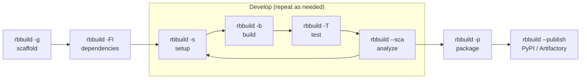

<!--
SPDX-FileCopyrightText: 2026 Robert Bosch GmbH
SPDX-FileContributor: Tolga Dalman

SPDX-License-Identifier: MIT
-->

# rbbuild

[](https://opensource.org/license/MIT)

*rbbuild* is a suite of software engineering tools covering many important
aspects of the whole product life-cycle. The suite comes with convenient user
interfaces for various tasks:
* Configuration and credential management for web services, including:
  Artifactory, Jira, Bitbucket, GitHub, FossID and SonarQube.
* Easy-to-use CLI wrappers for different tools, e.g., package/dependency
  managers (uv, pip, npm, Conan), build tools (GCC, clang, MSVC, Python build),
  documentation tools (Sphinx, Pandoc), and test tools (CTest, PyTest).
  All provided interfaces aim at hiding complex mechanisms behind simple yet
  powerful command-lines, designed for the needs of developers and (automated)
  build users.
* Integration of various toolchains (e.g., from an embedded SDK/BSP), allowing
  on-the-fly execution of build steps for different targets.
* Profiles and Channels enable powerful configuration of projects on various
  levels, e.g., per user, per project, or per repository.

*rbbuild* is implemented in Python and supports Linux and Windows host systems
(experimental support for MacOS).


## Installation

### Prerequisites

*rbbuild* requires Python 3.14 or newer. Install Python with the method of your choice, e.g.,
from [python.org](https://www.python.org/downloads/), with the package manager of your
operating system, or with [uv](https://docs.astral.sh/uv/) (`uv python install`).

*rbbuild* can be installed with any Python package installer, such as pip or uv.
We recommend the use of uv.

If your organization provides package mirrors or a dedicated rbbuild installation
guide, follow those instructions to configure your package installer.


### Install rbbuild

#### Prepare a virtual environment

A *venv* (virtual environment) is a dedicated folder for your rbbuild installation.
Multiple installations with different versions are possible. In this text, it is assumed that
`.cache/rbbuild` is your rbbuild venv path.

**Linux**
```bash
uv venv ~/.cache/rbbuild
source ~/.cache/rbbuild/bin/activate

# To use rbbuild CLI programs outside a venv, update PATH permanently
echo 'export PATH=$HOME/.cache/rbbuild/bin:$PATH' >> ~/.bashrc
source ~/.bashrc
```

**Windows (PowerShell)**
```powershell
uv venv ~/.cache/rbbuild
~/.cache/rbbuild/Scripts/Activate.ps1

# To use rbbuild CLI programs outside a venv, update PATH permanently
[System.Environment]::SetEnvironmentVariable('PATH', "$([System.Environment]::GetEnvironmentVariable('PATH','User'));$env:USERPROFILE\.cache\rbbuild\Scripts", 'User')
$env:PATH += ";$HOME\.cache\rbbuild\Scripts"
```


#### User installation and update steps

Install rbbuild into the venv:

```shell
uv pip install rbbuild
```

To upgrade later, re-run the same command with `--upgrade`.

For full profile configuration details see [rbbconf.md](documentation/user-manual/rbbconf.md).


#### Developer setup: using rbbuild from git sources

If you are contributing to rbbuild itself, rbbuild needs to be installed in the so-called [Development Mode](https://setuptools.pypa.io/en/latest/userguide/development_mode.html). To do so:

1. With a checked out [rbbuild git repository](https://github.com/boschglobal/rbbuild/), execute:

```shell
# Create and enter venv, if not already done
uv venv ~/.cache/rbbuild
source ~/.cache/rbbuild/bin/activate     # Linux
~/.cache/rbbuild/Scripts/Activate.ps1    # Windows PowerShell

cd ~/git/rbbuild                         # git source code path
uv pip install -e .[ui] --group dev
```

2. To run the rbbuild test suite after setting up the developer environment, see
[Tests](documentation/developer-manual/tests.md).


## Usage

*rbbuild* covers the whole build workflow with a few short commands, whatever
language and build system is used underneath:

```shell
rbbuild -g .         # scaffold a new project
rbbuild -FI          # fetch and install dependencies
rbbuild              # set up and build (same as rbbuild -sb)
rbbuild -T           # run tests and generate reports (test + coverage)
rbbuild --sca        # run static code analysis
rbbuild -p           # package the results
rbbuild --publish    # upload the packages to PyPI or Artifactory
```

The steps in the middle can be repeated as often as needed:



Each use case is available as a ready-to-run project with its own README in
[documentation/examples](documentation/examples):

* **C/C++ with CMake:** keep your plain `CMakeLists.txt`. Build, package and
  cross-compile with the same commands (`rbbuild -t <toolchain>`; `rbbuild -l`
  lists the toolchains of your profile). See
  [basic-cpp](documentation/examples/basic-cpp/README.md), and
  [zlib](documentation/examples/zlib/README.md) for building a third-party
  library from its upstream sources.
* **Python:** build wheels and source distributions, even several
  wheels from one repository. See
  [basic-python](documentation/examples/basic-python/README.md).
* **C and Python together:** one `rbbuild -sbp` compiles the C code and packs
  it into a platform-specific wheel. See
  [python-ctypes-c](documentation/examples/python-ctypes-c/README.md) and
  [python-cext-c](documentation/examples/python-cext-c/README.md).
* **Custom build scripts:** run any script instead of a build system. See
  [custom-build-scripts](documentation/examples/custom-build-scripts/README.md).
* **Dependencies:** declare packages from channels or plain URLs in
  [rbbuild.toml](documentation/user-manual/rbbuild.toml.md). rbbuild resolves
  the versions and reports conflicts.
* **SBOM and licenses:** every package comes with a `manifest.json` and a
  CycloneDX SBOM. `rbbuild --licenses` shows the license information.


### Tools

* [pkq](documentation/user-manual/pkq.md): query channels and packages,
  compare versions, search reverse dependencies.
* `rbbuild-gui`: graphical command center for browsing packages and editing
  dependencies and SBOM metadata.
* [rbfoss](documentation/user-manual/rbfoss.md): FossID integration for OSS
  scans.
* [rbbconf](documentation/user-manual/rbbconf.md): profiles, channels and
  service configuration.


## License

The material in this repository is licensed under [MIT License](LICENSE).
Third-party licenses are available after packaging as machine-readable `CycloneDX` or
`manifest.json` files in the build folder (obj).

A textual representation can be obtained via this call:

```
rbbuild --licenses
```


## Use of GenAI

This repository contains code generated by GenAI:
* GitHub Copilot Enterprise
* Models: Claude Sonnet [4.6, 5, 5.5]


## Authors and Maintainers

Authors and Maintainers of this repository are:
* [Tolga Dalman](mailto:Tolga.Dalman@bosch.com)


## Further documentation

### User manual
* [rbbuild](documentation/user-manual/rbbuild.md)
* [pkq](documentation/user-manual/pkq.md)
* [promote](documentation/user-manual/promote.md)
* [rbbconf](documentation/user-manual/rbbconf.md)
* [rbfoss](documentation/user-manual/rbfoss.md)
* [bash completion](documentation/user-manual/bash_completion.md)
* [rbbuild in comparison to other tools](documentation/user-manual/comparison.md)

### External pages
* [UV by Astral page from the Python@Bosch project](https://inside-docupedia.bosch.com/confluence2/x/cI3WQ).


