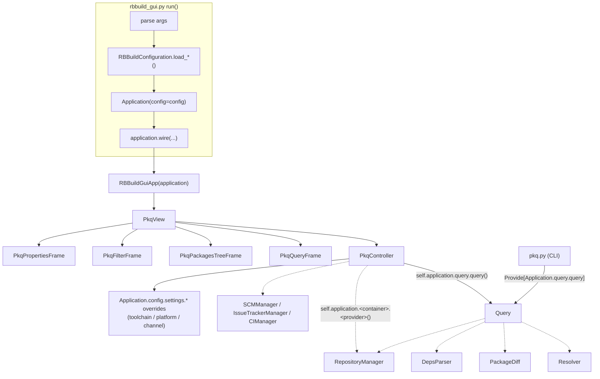

<!--
SPDX-FileCopyrightText: 2026 Robert Bosch GmbH
SPDX-FileContributor: Tolga Dalman

SPDX-License-Identifier: MIT
-->

# GUI Architecture

This document describes the architecture of *rbbuild*'s PySide6 (Qt)-based
GUI tooling (`rbbuild-gui`), how it integrates with the dependency-injection
(DI) container used by the rest of *rbbuild*, and how to add a GUI for
another tool (`rbbuild`, `rbfoss`, ...).

---


## Overview

`rbbuild-gui` is a standalone console script — it does **not** hang off a CLI
flag of `pkq` or any other tool. It bootstraps the same DI container as the
CLI tools, then hands control to a Qt application shell.

```
rbbuild/rbbuild_gui.py          entry point (argparse + DI bootstrap)
rbbuild/ui/app.py               RBBuildGuiApp: shared shell (tabs + sidebar)
rbbuild/ui/pkq/                 tool-specific GUI: package-query view
    view.py                     PkqView        (top-level content widget)
    control.py                  PkqController  (business logic / DI access)
    frm_query.py                PkqQueryFrame
    frm_tree.py                 PkqPackagesTreeFrame
    frm_filter.py                PkqFilterFrame
    frm_properties.py           PkqPropertiesFrame
rbbuild/ui/config/               rbbuild.toml/pyproject.toml editor container
    view.py                     ConfigEditorView (top-level content widget:
                                 sub-tabs + shared preview, whose header
                                 carries the Format combo; New/Open/Save/
                                 Save As live in RBBuildGuiApp's File menu,
                                 see below)
    project_view.py / project_control.py
                                 ProjectView / ProjectController ([project])
    rbbuild_view.py / rbbuild_control.py
                                 RbbuildSettingsView / RbbuildSettingsController
                                 ([rbbuild]/[tool.rbbuild])
rbbuild/ui/deps/                 "dependencies" sub-tab: deps/SBOM entry editor
    view.py                     DepsEditorView (mounted inside ConfigEditorView)
    control.py                  DepsEditorController (business logic, no Qt)
```


## Bootstrap

`rbbuild_gui.py`'s `run()` reuses the exact same configuration/DI bootstrap
every CLI tool goes through — parse args, build an `RBBuildConfiguration`,
construct the `Application` container — before handing off to the Qt
shell. There is no separate GUI configuration path: this is what
guarantees the GUI resolves profiles, toolchains and services identically
to the CLI for the same inputs.


## RBBuildGuiApp — the shared shell

`RBBuildGuiApp` (`rbbuild/ui/app.py`) is the `QMainWindow` shell shared by
every tool GUI. It owns the window chrome, menu bar, title and tab
container, but nothing about any tool's own business logic:

- **Tool content is swappable.** `set_content(widget)` replaces whatever
  is mounted in the first tab. This is the seam a second tool GUI would
  use to plug in — the shell itself would not need to change.
- **The Workspace Editor tab is the exception.** It's a `ConfigEditorView`
  owned directly by `RBBuildGuiApp` rather than swappable content, because
  it shares mutable state (`active_deps`) with the shell's sidebar.
- **The "Active Deps" sidebar** mirrors the same `active_deps` list the
  Workspace Editor's dependencies sub-tab edits. It's hidden whenever that
  sub-tab is already showing the same entries, and both views are
  refreshed together (`refresh_active_deps()`) so neither can drift out of
  sync with the other.
- The **File menu** (New/Open/Save/Save As Workspace) always targets the
  Workspace Editor regardless of which tab is active, switching to it
  first rather than disabling the menu items.

If/when a second tool GUI is added, none of this chrome needs to change —
only profile/channel switching, which currently lives one layer too low
(see "Known follow-ups"), would need to move up into this shell. How
multiple tool GUIs would be surfaced together (tabs, a launcher menu,
separate windows, ...) is a product decision left for when that need
actually arises.


## Shared business logic: Query

`pkq.py` (the CLI) and the GUI's `PkqController` both need to resolve
packages, walk dependency trees and diff versions — and both need that
resolution to behave *identically* (same conflict handling, same
channel/toolchain scoping, same tree-walking semantics). That logic lives
in `rbbuild/query/query.py`'s `Query` class, wired via `QueryContainer`
(`Application.query.query`), not in either the CLI or the GUI layer. Each
side only differs in how it *renders* `Query`'s results — as text (`pkq.py`)
or into a `QTreeWidget` (`frm_tree.py`). Any future shared behavior (e.g. a
`--format=json` output mode) belongs in `Query`, not duplicated in `pkq.py`
and `PkqController` separately.


## Tool-specific GUI: PkqController

Unlike the CLI "Main" classes, which use `@inject`/`Provide[...]` because
they never hold a container reference themselves, `PkqController` is
always constructed with a concrete `Application` instance and calls the
container directly wherever it needs a service. Business logic that must
match the CLI's behavior is delegated to `Query`; `PkqController` only
reaches into the container directly for view-only conveniences `Query` has
no reason to own (opening a package's URL, JIRA ticket or CI build link).
It surfaces query failures immediately via `term.error()` to the GUI's
Messages panel, since the GUI only ever resolves one query at a time —
unlike the CLI's batch commands, which run every item given and aggregate
failures across the whole batch.

All `frm_*.py` view classes only ever talk to `PkqController`'s
plain-Python API — they have no DI-specific code at all.


## Adding a package to the shared deps document

Packages found via the Package Query tab reach the shared
`RBBuildGuiApp.active_deps` document two ways — a context-menu action and
a drag-and-drop gesture onto the sidebar/dependencies sub-tab (implemented
at the widget level in `frm_tree.py`) — both ending up in the same
`PkqView.add_to_deps(pkg)` call. Neither `PkqPackagesTreeFrame` nor
`PkqController` know anything about `RBBuildGuiApp` or the sidebar; they
only call back through parameters `PkqView` is constructed with
(`active_deps`, `on_active_deps_change`, `deps_drop_target`), keeping
`pkq` decoupled from the shell.

The reverse direction — jumping from the dependencies sub-tab to the
Package Query tab to find something to add — works the same way in
miniature, via an `on_jump_to_pkq` callback threaded down from
`ConfigEditorView` to `RBBuildGuiApp`.


## The rbbuild.toml/pyproject.toml Editor: ConfigEditorView

`ConfigEditorView` (`rbbuild/ui/config/view.py`) is the container mounted
as `RBBuildGuiApp`'s second tab ("Workspace Editor"). It owns:

- an inner `QTabWidget` (`self.sub_notebook`) with one sub-tab per config
  section: "project" (`ProjectView`), "dependencies" (`DepsEditorView`),
  "rbbuild" (`RbbuildSettingsView`). Packaging (`[packaging.<pkgname>]`) is
  not yet implemented - it's by far the most complex section (dynamic
  per-package-name sub-tables, file-glob list editing) and is deferred to
  a follow-up,
- a shared, whole-document **Preview/Edit pane** below the sub-notebook,
  showing the TOML the next Save would write. Its header carries the
  Format combo (`rbbuild.toml`/`pyproject.toml`) in place of a plain
  "Preview" label - New/Open/Save/Save As themselves live in
  `RBBuildGuiApp`'s File menu, not here. A fresh, nothing-loaded editor
  shows the same fully-commented template `rbbuild -g` scaffolds a new
  project with, so it's a helpful example rather than an empty document;
  the first real edit to a section replaces that section's commented
  example rather than leaving it alongside the real value.

Every sub-tab's widgets and the preview `QPlainTextEdit` are editable
immediately - there is no read-only/Edit toggle. "Save" just applies any
pending manual preview edits (see below) and writes the file.

### Per-section controllers share one contract

Each sub-tab is backed by an independent, UI-framework-free controller
(`ProjectController`, `DepsEditorController`, `RbbuildSettingsController`)
that only models its own section of the TOML file, behind the same
four-method API:

- `open_file(path)` / `new_document(...)` - load/reset this section's state.
- `load_from_text(text)` - re-parse arbitrary TOML text (e.g. a
  hand-edited preview) into this section's state, in place.
- `patch_into_text(base_text)` - fold this section's table into
  `base_text`, leaving every other section untouched.
- `save_file(path)` - read-patch-write.

Because each controller only ever touches its own table, "Save" is just
calling all three controllers' `save_file()` in sequence - there is no
dedicated "combined save" logic anywhere, and the same composability is
what lets the preview pane render the *whole* document by chaining
`patch_into_text()` across all three.

### The preview pane is a two-way, explicitly-synced view

The pane always shows the TOML the next Save would write, generated from
the structured controllers. It is also directly editable, as a shortcut
for edits the structured sub-tabs have no UI for - but a typed edit only
takes effect once "Apply" re-parses it back into the controllers' models.
Until then, the view intentionally stops re-rendering from the model, so
an unrelated change elsewhere (e.g. a flag flipped in another sub-tab) can
never silently clobber an unapplied manual edit. "Save" always applies a
pending edit first, so nothing is ever discarded silently; if the edited
text doesn't parse, both Apply and Save fail loudly instead.

### Section-specific notes

- `ProjectView` only exposes `name`/`branch`/`version` - `license`,
  `authors`/`maintainers` and `scripts` have no dedicated widgets and are
  edited via the preview instead, though the controller still models all
  of them so they round-trip on save.
- `RbbuildSettingsView`'s `actions`, `build_tools`, `documentation_tools`,
  `test_tools` and `sca_tools` are fixed enumerations shown as checkbox sets.
  `build_tools` additionally tracks a user-chosen order (it's the only one
  of them whose execution order actually matters at build time),
  reordered via Up/Down buttons next to the checkboxes.
- `DepsEditorView` has an extra "Section settings" panel for attributes
  that apply to a whole `[[dependencies]]` section rather than one entry
  (`namespace`, `restrict_platform`, `build_only`, ...).

### Opening and saving the dependencies section

The two supported file formats keep their own table name - bare
`[[dependencies]]` in `rbbuild.toml`, nested under
`[tool.rbbuild.dependencies]` in `pyproject.toml` - and
`DepsEditorController` picks the right one from the target filename.
Entries are parsed with the same `DepsParser` the CLI uses (via
`Application.deps.parser()`), so an entry edited in the GUI resolves
identically to the CLI, and each parsed package remembers its origin
section so `save_file()` only rewrites the sections that actually changed,
preserving every other section-level key and any non-dependencies file
content untouched. `Patcher` is built on `tomlkit` (unlike the CLI's
`tomllib`-based parsing elsewhere), which is what lets comments and
formatting anywhere in the file survive an open/edit/save round-trip.

New/Open/Save Workspace live in `RBBuildGuiApp`'s File menu, using the
native `QFileDialog` for folder selection; an "Unsaved changes" label next
to the Format combo reflects whether any section or the preview has
pending edits.

### Format is fixed once a document is loaded; Save As is how you change it

The Format combo only decides the table layout for a document that
hasn't been saved to a real path yet (a fresh editor, or one just started
via File > New Workspace). Once a document is loaded from - or has been
saved to - an actual `rbbuild.toml`/`pyproject.toml` path, Save always
writes back to that same path regardless of the combo: switching the
combo for a loaded document is a no-op on Save, other than a
`term.warning` telling the user their change wasn't applied. This avoids
a footgun where flipping the combo out of habit while reviewing an
already-open file would otherwise silently start writing under the wrong
table layout. Actually converting a document between the two formats
goes through File > Save As instead, which writes a full copy under a
chosen filename/folder - each section controller re-derives its table
from that new filename exactly as it would for a freshly opened file.


## Runtime toolchain / platform / channel switching

`Toolchain` and `Channel` are `Factory` providers in `Core` — a fresh
instance is built from *current* configuration values every time they are
called. Switching the toolchain combobox in the GUI works by overriding the
relevant `Configuration` leaves and letting the next query naturally pick
them up (`Application.config.settings.platform/toolchain.override(...)`).
`DepsParser` (a `Singleton`) stores the `channel_factory`/`toolchain_factory`
*callables* themselves (not resolved values), so it keeps reading live
config on every call — no manual cache invalidation is needed anywhere.


## Switching profile

> **Note:** profile/channel/toolchain switching (the comboboxes in
> `frm_query.py`, `PkqController`, and the `switch_profile()`/
> `build_application()` closures in `rbbuild_gui.py`'s `run()`) is
> `pkq`-specific today only because `pkq` is the only tool GUI that
> exists — see "Known follow-ups" for the plan to move it into
> `RBBuildGuiApp` once a second tool GUI needs it too.

Profile is **not** switched the same way as toolchain/channel — overriding
`config.profile.*` in place would be unsafe, for two reasons:

- `load_profile()` merges a profile's TOML into the config tree rather
  than clearing it first, so loading a second profile on top of the first
  risks stale keys leaking from the old one.
- The DI container's core services (`RepositoryManager`, `Resolver`,
  `DepsParser`, `SCMManager`, `IssueTrackerManager`, `CIManager`) are all
  `Singleton` providers that capture config values once, at first access —
  changing `config.profile.*` afterwards wouldn't rebuild them.

So switching profile rebuilds the whole DI container from scratch —
exactly what every CLI invocation already does — and only remounts a
fresh `PkqView` once the new container has built successfully, so a
failed switch (bad TOML, unknown profile, ...) leaves the current view
untouched. The list of available profiles needs no separate discovery
step either: `RBBuildConfiguration.load_profile()` already scans the
profile directories and records the result in `config.profiles`.
Rebuilding `PkqView` from scratch also naturally resets its query state to
the new profile's defaults.


## Target architecture



`pkq.py` is included in the diagram only to show that it shares the same
`Query` node as `PkqController` — the CLI itself is bootstrapped completely
separately (see `run()` in `pkq.py`), not through `RBBuildGuiApp`.


## Adding a GUI for another tool

1. Create `rbbuild/ui/<tool>/` with a `<Tool>View(QWidget)` and a
   `<Tool>Controller` following the same split as `pkq` (controller = DI +
   business logic, view = Qt composition, `frm_*.py` = individual
   widgets talking only to the controller).
2. Reuse `RBBuildGuiApp` — construct it (or receive it) and call
   `app.set_content(SomeToolView(app.notebook, application, args))`.
3. Do not add `@inject`/`Provide[...]` to the new controller unless it is
   ever constructed without a container reference; direct container access
   is simpler and equivalent.
4. If the new controller needs config-driven runtime switching (toolchain,
   channel, ...), use `Application.config.settings.*.override(...)` — do not
   invent a parallel mechanism.


## Adding rbbuild build/publish operations to the GUI (investigation)

`rbbuild-gui` today only exposes read-only *querying* (`pkq`) and local,
in-memory *editing* (the deps/SBOM editor) — it does not invoke any of
`rbbuild`'s own build actions. This section is a written investigation of
what it would take to add them, done as part of the deps-editor ticket's
acceptance criteria but deliberately **not implemented**: none of the
ticket's actual acceptance criteria need it, and the risk profile below is
reason enough to design it as its own follow-up ticket rather than bundle
it in here.

### The action model

`rbbuild`'s CLI (`RBBuildMain.run()` in `__main__.py`) is a single ordered
chain of *actions* selected by flags (`-F` fetch, `-I` install-deps, `-s`
setup, `-b` build, `--sca`, `-i` install, `-T` run_tests, `--publish`, `-x`
execute, `-D` documentation, `-p` package), plus two standalone ones not
part of the chain (`--upload`, `--delete`). Every action is just a plain
method on `RBBuildMain` (`self.build(...)`, `self.publish(chname)`, ...)
that pulls its dependencies from `Application` via `@inject`/`Provide[...]`
— the same container `rbbuild-gui` already bootstraps. There is nothing
CLI-specific blocking any of them from being called from a GUI controller;
the work is entirely about *which* to expose and *how safely*.

### Risk categorization

- **Local, non-destructive** (`setup`, `build`, `install`, `run_tests`,
  `documentation`, `package`, `static_code_analysis`, `licenses`): only
  read/write `obj/`/`staging/<tcid>` under the project tree. Safe to expose
  behind a plain "Run" button — worst case is a bad local build, fixed by
  re-running.
- **Local, destructive but recoverable** (`clean`): deletes `obj/` (and, with
  `-f`, `staging/<tcid>`). Recoverable by rebuilding, but should still get a
  confirmation dialog in a GUI, since a misclick is easier than a mistyped
  CLI flag.
- **Remote, mutating, but permission-gated** (`publish`, `upload`): write to
  Artifactory. Already gated server-side by `Channel.permissions`
  (`'upload'`/`'overwrite'`/`'delete'`, checked in `RBBuildMain.publish()`
  and `RepositoryManager.delete()`) — a channel configured read-only in
  `rbbuild.toml`/the profile TOML rejects these regardless of what the GUI
  does. `publish` also silently retries on `VersionConflictError` by
  bumping a 5th version digit — fine for CLI (it already logs a
  `term.warning`, which the GUI's Messages panel captures for free via
  `console_capture`), but a GUI should still surface each retry prominently
  (e.g. a progress line), not just log it, since a user watching a GUI is
  less likely to be scrolling raw log output like a CLI user would.
- **Remote, destructive, unconfirmed today** (`delete`): deletes the first
  version matching `target` with **no confirmation at all** at the CLI
  layer (`RBBuildMain.delete()` calls `repoman.delete(pkg)` immediately).
  That is acceptable for a CLI, where invoking it requires deliberately
  typing the exact package/channel out — it is not acceptable for a GUI
  button, which is far easier to trigger by accident. If `delete` is ever
  exposed in the GUI it needs its own explicit confirmation step (e.g.
  requiring the user to retype the package string, not just click "OK"),
  and should not simply reuse `RBBuildMain.delete()`'s current
  no-questions-asked behavior.
- **`promote.py`** (a separate entry point, not part of `rbbuild`'s action
  chain): moves already-published packages between channels
  (`PromoteMain.do_promote()`). Same remote-mutation risk class as
  `publish`/`upload` — same recommendations apply.

### Credentials

`RemoteService`/`AuthMethod` (`rbbuild/service/remote_service.py`) reads
credentials from whatever the profile/environment already provides
(`BASIC`/`BEARER_TOKEN`) — there is no interactive credential prompt
anywhere in `rbbuild` today. A GUI wrapper must keep it that way: reuse the
exact same `Application` container the CLI uses (as `rbbuild-gui` already
does for querying) rather than adding any GUI-side credential entry,
storage, or caching. This also means a GUI "Publish" button can fail with
an auth error exactly like the CLI would if the environment isn't set up
— that failure needs to surface clearly (Messages panel), not silently.

### Execution model

Every one of these actions can take long enough (network I/O, compilation)
that it must not run on the Qt main thread. `PkqView`/`PkqController`
already solved this for querying with `AsyncTaskQueue`
(`rbbuild/ui/async_task.py`) — one task at a time, background thread,
progress/result marshaled back to the main thread via polling. Any future
build/publish controller should reuse `AsyncTaskQueue` rather than invent a
second threading mechanism.

### Recommendation

No build/publish actions are added to the GUI as part of this ticket. If a
future ticket takes this on:

1. Start with the local, non-destructive actions (setup/build/install/
   test/package/documentation) behind a single "Run" panel, reusing the
   existing action-name strings from `parse_command_line()`, with output
   streamed into the Messages panel via `AsyncTaskQueue`.
2. Add `publish`/`upload` only once a confirmation + dry-run-by-default UX
   exists, and make version-conflict retries visible as they happen, not
   just logged.
3. Treat `delete` (and channel-mutating `promote.py` operations) as
   out-of-scope until a dedicated, explicit confirmation UX is designed for
   them specifically — do not wire them up using the same "Run" panel as
   the safe actions.
4. Follow "Adding a GUI for another tool" above either way — a `<Tool>View`/
   `<Tool>Controller` pair reusing `RBBuildGuiApp`, not new chrome.


## Known follow-ups (not yet done)


- Profile/channel/toolchain switching (the comboboxes in `frm_query.py`,
  `PkqController.select_platform_toolchain()`/`select_channel()`, and the
  `switch_profile()`/`build_application()`/`mount_pkq()` closures currently
  local to `rbbuild_gui.py`'s `run()`) lives entirely inside the `pkq`
  tool GUI, even though profile/channel/toolchain are DI-container-wide
  concepts, not `pkq`-specific ones. This was fine while `pkq` was the only
  tool GUI, but every future tool GUI (`rbbuild`, `rbfoss`, ...) would
  otherwise have to reimplement the same combobox + full-container-rebuild
  dance. When a second tool GUI is added, move this up into
  `RBBuildGuiApp`:
  - `RBBuildGuiApp` grows the profile/channel (and possibly toolchain)
    comboboxes as part of its own chrome, alongside the existing Messages
    panel.
  - `RBBuildGuiApp` owns `switch_profile()`/`build_application()` directly,
    since rebuilding the DI container and remounting the current content is
    a shell-level concern, not a `pkq`-level one.
  - `set_content()`'s caller no longer needs an `on_profile_change` callback
    threaded through the tool view (`PkqView.change_profile()` and its
    relaying to `rbbuild_gui.py` can be removed once `RBBuildGuiApp`
    triggers the rebuild itself and simply remounts whichever tool view is
    currently active).
  - Per-tool controllers (`PkqController`, ...) stop owning
    `select_platform_toolchain()`/`select_channel()`; they only read the
    *current* `Application.config.settings.*`, the same way `Query` does.
- `CIService`/`CIManager` currently only has a `Jenkins` implementation. A
  `GitHubActions(CIService)` class would slot in next to `jenkins.py` and be
  registered in `CIContainer` the same way `bitbucket.py`/`github.py` both
  implement `GitRepository` under `SCMContainer`.
- `[packaging.<pkgname>]` has no editor sub-tab yet in `ConfigEditorView` -
  deferred due to its complexity (dynamic per-package-name sub-tables,
  file-glob list editing for `files`/`exclude`/`shared-data`). `[oss]`,
  `[cmake]` and `[pandoc.<name>]`/`[sphinx.<name>]` are lower priority
  still and may need their own sub-tabs (or a "more..." overflow) once
  added, given how many sub-tabs the notebook already has.

